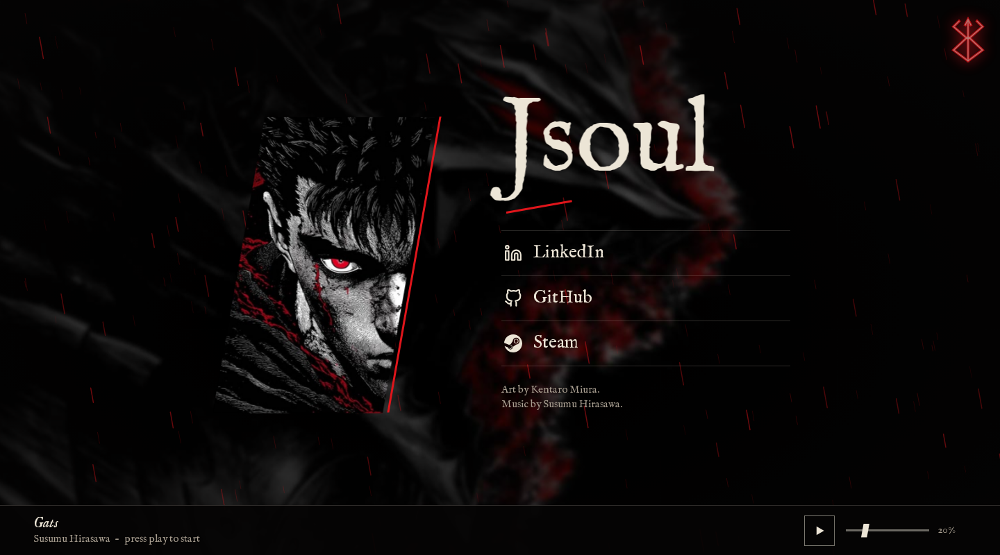

# Jsoul

A dark, Berserk-themed personal profile page. Plain HTML, CSS and JavaScript (ES modules), no build step.



## Features

- **ASCII entrance**: the "Jsoul" wordmark is drawn in ASCII characters, one layer per letter. The layers move at different depths with the pointer (parallax), the characters shimmer, and a red lens follows the cursor. On touch screens it drifts on its own.
- **The cut**: clicking the gate splits the screen along a red slash and reveals the profile.
- **Music dock**: play/pause and volume. The mouse wheel changes the volume by 2% per notch.
- **Accessibility**: keyboard operable, respects `prefers-reduced-motion`, and the links still show without JavaScript.

## Project structure

```
.
├── index.html
├── favicon.svg
├── README.md
├── .gitignore
├── .nojekyll
├── docs/
│   └── preview.png
└── assets/
    ├── audio/        gats.m4a
    ├── fonts/        Archivo Black, IM Fell English (woff2)
    ├── images/       avatar.jpg, backdrop.jpg
    ├── css/
    │   ├── base.css       fonts, design tokens, reset
    │   ├── gate.css       ASCII gate and the cut transition
    │   ├── profile.css    backdrop, rain, portrait, name, links
    │   └── player.css     music dock
    └── js/
        ├── main.js        entry point
        ├── gate.js        ASCII gate and the cut transition
        ├── wordmark.js    builds the ASCII letter layers
        ├── pointer.js     shared pointer and parallax state
        ├── parallax.js    profile parallax
        ├── rain.js        rain canvas
        ├── player.js      audio, volume, wheel control
        ├── title.js       tab title effect
        └── utils.js       small helpers
```

## Run locally

The scripts are ES modules, so open the site through a local server rather than from `file://`:

```
npx serve .
```

or use the VS Code Live Server extension. GitHub Pages serves it as is.

## Credits

- Art by Kentaro Miura (*Berserk*).
- Music by Susumu Hirasawa (*Gats*).
- Fonts: Archivo Black and IM Fell English, both under the SIL Open Font License.
- Link icons: Feather Icons and the Steam mark.
